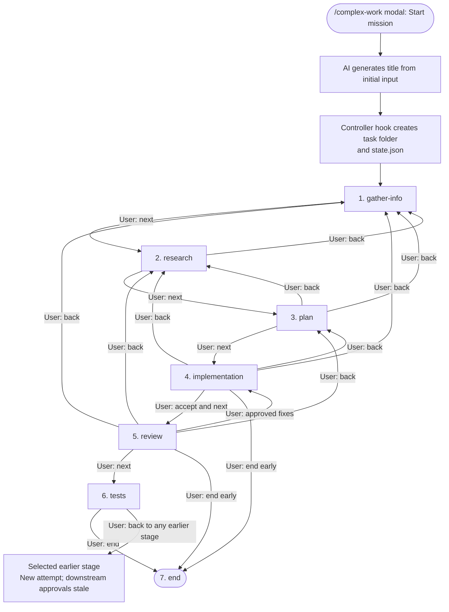
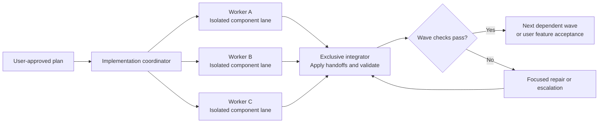

# Complex Work: SDLC workflow analysis

Status: historical design reference. The implemented MVP now uses an XState-owned full-screen workspace (screen states plus a parallel order-execution region), per-mission Git worktrees, scoped agent commits, and a separate explicit merge/close gate. Older modal, no-commit, and tests-to-end proposals below are superseded; see the [operator guide](complex-work.md) for current behavior and limits. Manual UI acceptance comes before a quality pass. Automated end-to-end tests remain deferred.

## 1. Recommended approach

Build `/complex-work` as a Pi extension backed by a small, durable workflow state machine. Workflow definitions describe stages, agent assignments, outputs, and permitted transitions; the controller handles execution, persistence, and user decisions.

Ship one selectable workflow initially: `complex-task`. Keep a registry so additional workflows can be added without rewriting the command or UI. Do not build a general-purpose workflow language or graphical editor for the first release.

Principles:

- Each work stage has its own specialist agent and fresh context.
- Agent prompts are short, concise, and military-style: clear orders, boundaries, findings, stop.
- Agents write findings and may recommend actions in prose; only explicit user actions in the TUI modal trigger stage transitions.
- No structured model output, inferred verdict, or report parsing selects or authorizes a transition.
- Agent completion updates execution status only; it does not change the current stage.
- The controller coordinates but does not implement the feature itself.
- Implementation may delegate bounded tasks to multiple focused agents.
- Durable artifacts, not growing chat history, carry knowledge between stages.
- Any stage may return to any earlier visited stage, including non-adjacent stages.
- Returning to a stage does not undo code automatically.
- The user may explicitly end from implementation or review, without completing later stages.
- `end` is a terminal control node, not an LLM task. There is no useful agent work to do there.

Use the canonical stage identifier `implementation` (correcting `implemetation`).

## 2. Workflow diagram

Every stage-to-stage edge below represents an explicit user action, never a model decision or automatic completion hook. Labels are user intent, not parsed report verdicts. The requested non-adjacent returns and early-end actions are shown explicitly; the transition table is authoritative for the full set.



### Deterministic transition rules

| Current stage | Forward action | Allowed backward targets | Other actions |
| --- | --- | --- | --- |
| `gather-info` | `research` | None | Retry, pause, cancel |
| `research` | `plan` | `gather-info` | Retry, pause, cancel |
| `plan` | `implementation` | `gather-info`, `research` | Retry, pause, cancel |
| `implementation` | `review` | `gather-info`, `research`, `plan` | End, retry, pause, cancel |
| `review` | `tests` | `gather-info`, `research`, `plan`, `implementation` | End, retry, pause, cancel |
| `tests` | `end` | `gather-info`, `research`, `plan`, `implementation`, `review` | Retry, pause, cancel |
| `end` | None | Earlier visited stages only through explicit reopen | Inspect artifacts |

Backward targets must have been visited. Retry creates a new attempt without changing the stage. Forward transitions record the user's approval of the current artifacts; implementation → review records feature acceptance. Early end records that later gates were not completed. No model-returned field is consulted for these actions.

## 3. Stage contracts

| Stage | Agent responsibility | Required output | Decision gate |
| --- | --- | --- | --- |
| `gather-info` | Ask about the problem, users, expected behavior, scope, constraints, and acceptance criteria. Inspect architecture and similar features to understand project fit. | Task brief, project map, acceptance criteria, non-goals, assumptions, open questions. | Continue to research or clarify further. |
| `research` | Investigate relevant code paths, contracts, dependencies, feasibility, technical risks, and viable implementation directions. Separate facts from assumptions. | Evidence-backed technical report, alternatives, recommended direction, risks, unanswered questions. | Approve direction, request further research, or return to gather-info. |
| `plan` | Convert the approved brief and research into executable tasks, dependencies, independent lanes, integration gates, and validation commands. | Markdown plan; task IDs, ownership, dependencies, lane isolation, expected handoffs, acceptance checks. | Approve execution, retry, or return to gather-info/research. |
| `implementation` | Execute only the approved plan. Delegate focused tasks where genuinely independent, integrate results, and run existing validation. | Candidate diff, task outcomes, validation evidence, deviations, blockers, feature demonstration instructions. | Accept and proceed, retry, return to any earlier stage, or end. |
| `review` | Independently inspect the exact accepted candidate against requirements, architecture, security, maintainability, and regression risks. Do not edit code. | Findings with severity, file/line evidence, suggested fixes, and unresolved validation gaps. | Proceed to tests, retry, return to any earlier stage, or end. |
| `tests` | Derive unit and E2E coverage from acceptance criteria and review risks. Add appropriate tests and run both new and relevant existing checks. | Coverage map, changed test files, commands, results, and any environment limitations. | Accept passing evidence, revise tests, or return earlier. |
| `end` | Stop execution and preserve the final state. | Completion summary and artifact references generated by the controller. | None; no further agent is launched. |

### Clarification and acceptance

All work specialists call `interview(async:false)` for missing decisions, batch relevant questions with reasoned recommendations, and retain Q&A in their findings. The tool-free title namer does not interview. A child-only proxy transports versioned, correlated request/reply files under `.interviews/<stage-run-id>/`; the owning interactive session invokes the installed pi-interview provider with its real UI context. This avoids native pi-interview's headless-child restriction and a competing terminal renderer.

The broker watches durable files (no status polling), validates task/run/session identity, serializes forms, handles abort/cancellation, and closes pending forms on navigation or shutdown. The child transport deadline includes queue time (15 minutes by default, capped at one hour); pi-interview retains its own form timeout. Answers clarify work; they never change workflow state. Interrupted/unavailable interviews remain blockers. Delegates receive the bounded `complex-work.interview/1` extension binding unchanged. Historical records and report answers survive retry.

The research agent may recommend `gather-info` or `plan`, but cannot select the next stage. The same rule applies to every agent recommendation.

Feature acceptance after implementation means the behavior is acceptable for independent review, not that the work is release-ready. Fully validated completion requires accepted review and test evidence. The user may nevertheless end from implementation or review; this must be recorded as `ended-early`, not as fully validated completion.

### Review fixes and test failures

Review does not silently apply fixes. The user approves the findings to address, then returns to `implementation` with a focused correction packet. The updated candidate requires feature acceptance and a new review before tests.

If tests uncover a feature defect, return to implementation. Preserve the new tests as evidence, then rerun review and tests against the repaired candidate. A test-only problem may retry the tests stage; production-code changes belong to implementation.

Creating dedicated new unit/E2E coverage remains after acceptance and review, as requested. Implementation should still build, typecheck, and run existing tests; delaying test creation must not mean delaying all validation. A missing E2E environment is a blocker or an explicit recorded coverage exception, not a passing result.

## 4. Architecture and repository fit

### Existing foundations

The repository already provides:

- `pi/agent/prompts/coordinator.md`: a manual research → plan → execution orchestration prompt.
- `pi/agent/agents/research-unit.md` and `plan-unit.md`: fresh-context research and planning profiles.
- `sergeant-unit.md`, `work-unit.md`, and `integrator-unit.md`: execution leadership, workers, and integration.
- `review-unit.md`: a read-only reviewer.
- `pi-subagents` and `pi-interview` in `pi/agent/settings.json`.
- A global concurrency limit of four in `pi/agent/extensions/subagent/config.json`.

The prompt alone is not enough to enforce transitions, persist pending approvals, or reconcile interrupted runs. Use an extension for those guarantees.

### Proposed components

1. **Modal entry point:** bare `/complex-work` opens mission control; reject arguments and identify the selected run inside the modal.
2. **Workflow registry:** validate versioned definitions and resolve `complex-task`.
3. **Controller:** validate transitions, dispatch one stage, reconcile completion, and stop at user gates.
4. **Agent runner adapter:** use supported pi-subagents execution and supervisor interfaces; expose run IDs, execution status, actual agent/model metadata, and interruption. Agent reports are Markdown files, not machine-readable routing outputs.
5. **Artifact/state store:** save attempts, output references, decision history, and repository fingerprints.
6. **UI adapter:** present summaries and permitted actions; never decide transitions independently of the controller.

`/complex-work` opens a single `ctx.ui.custom` TUI overlay with a multiline task/feedback editor, live stage, read-only Markdown reports, stored-task selection, and permitted actions. Tab switches focus; ↑/↓ select actions even from the task/feedback input; Enter submits; Shift+Enter adds a line; Escape closes the panel without cancelling execution. Confirmed orders carry task identity and displayed revision; late evidence forces reconfirmation. No command lock is held while the user reads the panel. There are no steering subcommands or diagnostic command fallback; non-TUI modes cannot issue orders or infer approval.

The planning packet includes authenticated, session-scoped model IDs verified for workers/integrators through the public pi-subagents preflight export. Every task and integration gate recommends model, effort, rationale, and fallback in Markdown. Recommendations are advisory: accepting the plan does not automatically assign models; separate user orders and launch-time policy checks are required.

The installed subagent package supplies execution primitives, not this user-directed SDLC state machine. Its scripts can handle implementation waves with `runs.all`/`runs.run`; do not put the entire human-gated lifecycle into one long-running script waiting for user input.

Before implementation, verify the installed package's supported extension invocation, async completion, supervisor, and worktree handoff contracts. Do not assume a command handler can execute another extension's tool directly or import its internal runner. Keep the integration behind the runner adapter.

### Agent profiles

Proposed stage owners:

- New `gather-info-unit`.
- Existing `research-unit`, with a workflow-specific output contract.
- Existing `plan-unit`, with a Markdown plan contract.
- Existing `sergeant-unit`, adapted as the implementation coordinator.
- Existing `review-unit`, kept read-only.
- New `tests-unit`, scoped to test code and permitted test-support files.

Each agent writes its own findings file within the task folder, including delegated workers and integrators. Research and planning may write only their assigned findings, not production code. The reviewer remains read-only with respect to production code but needs narrowly scoped permission to write its findings; its current blanket no-edit rule must be adapted accordingly. The controller alone creates task folders and modifies `state.json` and approval history. Agent file-write boundaries must not grant state-file access.

### Necessary policy reconciliation

The current planner and sergeant explicitly allow parallel writers in the same worktree. This differs from the installed subagent guidance requiring one writer per checkout/worktree. Do not reuse those profiles unchanged for this workflow.

Recommended policy: independent component writers use separate isolated lanes; a separate integrator owns the integration checkout exclusively. Tightly coupled work remains serial. No agent automatically stages, commits, merges, publishes, stashes, or discards user work without explicit permission.

Managed worktree runs may capture patches and clean up at completion. Persist durable handoffs and apply them into a retained candidate checkout through the supported lifecycle before review. Do not assume a child's temporary worktree will still exist for later stages.

## 5. Parallel implementation and context control

The plan should be a dependency graph, presented as waves for readability. Each task needs:

- Stable ID, objective, and acceptance criteria.
- Dependencies and input artifact versions.
- Exclusive file/contract ownership and integration target.
- Relevant files and approved constraints.
- Validation requirements and expected handoff.
- Stop conditions and clarification questions.
- Catalog-backed per-task model recommendation, effort, rationale, and fallback; no automatic assignment.



Parallelism is earned by independence, not by assigning more agents. Respect the configured global concurrency limit across the coordinator and its descendants; do not assume four worker slots are always available.

Every stage attempt starts with fresh context: task summary, relevant approved artifacts, repository/candidate identity, scope, and required output. Workers receive only their task packet and necessary shared contracts. Reviewers receive the brief, diff, acceptance criteria, and applicable evidence, not the implementer's full conversation.

A blocked agent should ask specific questions through its bridged interview tool. No child may advance the main workflow or accept its own work.

## 6. Modal-only workflow steering

`/complex-work` is the sole entry point and accepts no arguments. Start missions, select stored tasks, inspect reports/state, approve stages, return earlier, retry with feedback, pause/resume, cancel, end, reopen, and refresh execution evidence inside its TUI modal. There is no slash-subcommand or headless automation interface.

If multiple runs exist, select one in the modal. Forward approval applies only to the selected run's currently displayed decision and artifact versions; it cannot approve work still running or stale evidence. At the implementation gate it explicitly records feature acceptance.

The decision view shows the stage summary, agent recommendation and rationale, relevant artifact links, validation status, and allowed actions from the fixed transition table. Recommendations are informational only. All modal actions call the fixed transition handler; slash command arguments are rejected without steering the workflow. The back menu contains every earlier visited stage, not just the adjacent one. Escape dismisses the dialog and leaves the run awaiting a decision.

While a stage runs, back/end/cancel first requests interruption, waits for all descendants to stop, captures partial work, then applies the user action. Never launch a replacement writer while previous ownership is uncertain. Ending during incomplete tests is recorded as ended-early, not validated completion.

## 7. Durable state, backward navigation, and recovery

### Task creation hook and agent-owned files

Create every task under `<project-root>/docs/tasks/<date>-<title>-<short-hash>/`. Here `/docs/tasks` means project-root-relative, not the machine's absolute `/docs/tasks` directory.

On the user's start action:

1. The controller allocates a task ID and UTC creation timestamp and retains the initial input for bootstrap recovery.
2. A bounded title-generation agent returns a short plain-text title based only on the initial input. It does not create directories or choose paths. Record this bootstrap agent and its actual model in execution history.
3. The deterministic hook slugifies and length-limits the title, removes unsafe path characters, and appends the UTC date and a short hash derived from the task ID. It creates the folder exclusively, checks for collisions, and writes the initial `state.json` and `initial-input.md`.
4. The controller launches gather-info with the exact folder and report path. Subsequent agents receive their own exclusive report paths.

Folder creation and state initialization are idempotent for the same start request. A failed title call leaves the task in bootstrap state until an explicit retry or approval of a safe fallback title. Later title changes do not rename the folder. This is deterministic controller behavior around AI-generated content; model output cannot select arbitrary filesystem paths.

Example layout:

```text
docs/tasks/2026-10-07-add-workflow-controller-a1b2c3d/
  state.json
  initial-input.md
  01-gather-info-attempt-001.md
  02-research-attempt-001.md
  03-plan-attempt-001.md
  04-implementation-attempt-001.md
  04-worker-api-attempt-001-run-<id>.md
  04-worker-ui-attempt-001-run-<id>.md
  04-integrator-attempt-001-run-<id>.md
  05-review-attempt-001.md
  06-tests-attempt-001.md
```

Each report is owned by one agent execution. Reattempts get new files; finalized reports are preserved rather than overwritten. The controller reserves report identities but agents create and write the findings files themselves. A missing report leaves execution incomplete; its prose is never parsed to select a transition. Agents in isolated lanes must use an explicitly authorized central report path or a supported artifact transfer, not an assumed copy of the task folder.

### State JSON

Required user fields: current state, transition history including agents/models used, and creation date. Additional controller fields below support recovery and unambiguous history. This JSON is written by code, not requested as structured model output.

```json
{
  "schemaVersion": 1,
  "taskId": "<stable-id>",
  "workflow": "complex-task",
  "workflowVersion": 1,
  "title": "Add workflow controller",
  "createdAt": "2026-10-07T10:00:00Z",
  "updatedAt": "2026-10-07T10:15:00Z",
  "currentState": "implementation",
  "executionStatus": "running",
  "revision": 4,
  "outcome": null,
  "repository": {
    "root": "<project-root>",
    "baselineRef": "<git-ref-or-null>",
    "candidateFingerprint": "<fingerprint-or-null>"
  },
  "activeRuns": ["<implementation-run-id>"],
  "stageRuns": [
    {
      "runId": "<plan-run-id>",
      "stage": "plan",
      "attempt": 1,
      "agent": "plan-unit",
      "modelsUsed": [{ "provider": "openai-codex", "model": "<actual-model-id>" }],
      "status": "completed",
      "report": "03-plan-attempt-001.md",
      "startedAt": "2026-10-07T10:05:00Z",
      "finishedAt": "2026-10-07T10:14:00Z"
    }
  ],
  "history": [
    {
      "id": "<transition-id>",
      "at": "2026-10-07T10:15:00Z",
      "from": "plan",
      "to": "implementation",
      "action": "next",
      "actor": "user",
      "source": "tui",
      "reason": "Approved plan",
      "attempt": 1,
      "stageRunIds": ["<plan-run-id>"],
      "agentsUsed": [
        {
          "runId": "<plan-run-id>",
          "agent": "plan-unit",
          "modelsUsed": [{ "provider": "openai-codex", "model": "<actual-model-id>" }]
        }
      ],
      "approvedReports": ["03-plan-attempt-001.md"],
      "candidateFingerprint": "<fingerprint-or-null>"
    }
  ]
}
```

The example shows a representative run and transition; a real task retains its complete history, including initial creation. Transition history records executions used for the departing stage, including delegated workers. Destination executions are recorded when actually launched, not guessed at transition time. Use actual runtime model/provider identities, including model changes, rather than configured defaults. Unknown metadata must remain explicitly unknown.

Persist input/output versions, stale flags, initiating Pi session, and writer ownership alongside these fields as needed. Keep stage identity separate from execution status: `ready → running → awaiting-user`, with `blocked`, `paused`, `failed`, `ended`, and `cancelled` alternatives. Ending changes `currentState` to `end` and sets an outcome such as `validated`, `ended-early`, or `cancelled`; agent completion alone never does so.

Store compact session-entry references for UI restoration; task-folder state remains authoritative across restarts. Decide separately whether findings are committed to Git; do not implicitly ignore the requested documentation folder or commit it automatically. Initial input and findings may contain sensitive data and require a secrets policy.

Each decision records the user action, optional reason, stage attempt, state revision, and artifact/candidate versions it approves. Serialize mutations and acquire a per-task ownership lock so two sessions cannot drive the same task concurrently. Retain legacy `source: "command"` history for compatibility; new mission creation and actions record `source: "tui"`. Write JSON atomically and reject stale or duplicate actions. Retry, pause, resume, and cancellation events are recorded with the same user provenance even when the stage does not change.

### Returning to an earlier stage

Example: returning from review to research creates a new research attempt, retains previous evidence, and marks plan, implementation acceptance, review, and tests stale. Old code remains present until an explicitly approved correction changes it. Previously accepted requirements remain historical context, not automatic authority over the revised direction.

Conservatively invalidate downstream approvals after an earlier stage is revisited. The planner may propose reusing unaffected tasks, but the user must approve the revised plan. Reject late results from superseded attempts; preserve them as historical evidence only.

Git HEAD alone cannot identify an uncommitted candidate. Track relevant diff/content fingerprints as well as the baseline ref. If external edits change the candidate, mark affected approvals stale and require reconciliation.

### Interruption and completion

On reload or restart, reconcile saved run IDs with the runner before launching anything. A previously `running` record is not proof the agent stopped. Preserve partial diffs and unresolved ownership; surface infrastructure failure instead of silently changing execution mode.

`end` stops the task, clears active UI/execution state, and retains the reports. Ending from implementation or review records `ended-early` and the skipped gates. Ending from tests records `validated` only when the user explicitly accepts completed review/test evidence; otherwise it remains ended-early. The controller never infers passing tests from model prose. Where an objectively verified result is needed, use exit codes from controlled checks, not a model-returned verdict. It does not commit, merge, publish, or automatically delete worktrees. Ended tasks remain inspectable; returning from end requires an explicit reopen action that invalidates downstream acceptance before any new work.

## 8. First implementation scope and verification

Suggested implementation sequence:

1. Define the fixed user-action transition table, Markdown findings contracts, workflow registry, and tests for the pure controller.
2. Add the title bootstrap and deterministic task-folder hook, `state.json`, state revisions, ownership, and stale-artifact rules.
3. Prove the supported Pi/subagent adapter with one bounded stage, including interruption and clarification.
4. Add bare `/complex-work` and one modal containing input, decisions, reports, live status, and recovery actions.
5. Add gather-info/tests profiles and adapt existing profiles and lane policies.
6. Wire the full `complex-task` lifecycle and isolated implementation waves.
7. Exercise interruption, restart, late completion, external edits, and full end-to-end flow.

Acceptance checks for the workflow engine:

- Every stage has a distinct specialist owner; no model output or agent completion changes the stage.
- Modal actions use the fixed transition table, including every requested return path and early end; slash command arguments are rejected.
- The deterministic start hook creates one safe task folder and JSON state per task; each agent creates its own findings file.
- Transition history includes timestamps, user provenance, attempts, and actual agents/models used.
- Research can recommend returning to gather-info without moving automatically.
- Implementation cannot proceed without approval of the current plan version.
- Every earlier visited stage is reachable through the modal.
- Back-navigation preserves evidence and code while invalidating downstream approvals.
- Review fixes pass through implementation, renewed feature acceptance, and review.
- New tests run only after accepted feature/review gates; early ending does not imply those gates passed.
- No structured output or report parsing is required from models; check results come from controlled execution evidence where needed.
- Parallel writers do not share a writable checkout; integration starts after handoffs settle.
- A restart or duplicate modal order does not dispatch the same stage twice.
- A late completion cannot replace a newer attempt's output.
- Cancelling leaves no live writer and does not discard user changes.
- `end` launches no LLM and performs no implicit publication.

Out of scope initially: arbitrary user-authored executable workflows, automatic release/PR actions, distributed scheduling, and a visual workflow editor.

## 9. Decisions to confirm before coding

Recommended defaults, not additional requirements:

- Human approval at every stage boundary; no automatic forward progression.
- Read-only review, with approved fixes routed back to implementation.
- Conservative downstream invalidation on back/retry.
- Isolated writer lanes and exclusive integration.
- Unified TUI modal first; child clarification forms are bridged to the owning main session.
- Task folders under project-root `docs/tasks`, agent-owned Markdown findings, and controller-owned JSON state.
- `end` preserves artifacts and distinguishes validated completion from early termination.
- No implicit Git publication.

These defaults preserve user control while keeping the first version small enough to maintain.
